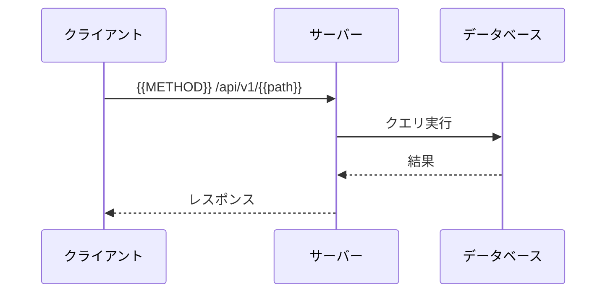

# {{API名}}

（この API 群の概要を記述。`04_API仕様/API設計書.md` に節を追加するときの雛形として使う。`openapi.yaml` にも同じ内容を書く）

## `{{METHOD}} /api/v1/{{path}}`

### 概要

（エンドポイントの説明）

- **認証**: 要 / 不要
- **権限**: （呼び出せるロール）
- **対応する要件**: {{FR-XXX-01}}

### リクエスト

**ヘッダー**

| ヘッダー | 値 | 必須 |
|---|---|---|
| Authorization | Bearer {token} | Yes |
| Content-Type | application/json | Yes |

**パスパラメータ**

| パラメータ | 型 | 必須 | 説明 |
|---|---|---|---|
| id | string | Yes | リソース ID |

**リクエストボディ**

```json
{
  "field": "value"
}
```

| フィールド | 型 | 必須 | 桁数・範囲 | 説明 |
|---|---|---|---|---|
| field | string | Yes | 1〜100 文字 | フィールドの説明 |

### レスポンス

**成功（200）**

```json
{
  "id": "xxx",
  "field": "value",
  "createdAt": "2026-01-01T00:00:00Z"
}
```

**エラー**

| ステータス | エラーコード | 発生条件 |
|---|---|---|
| 400 | VALIDATION_ERROR | 入力値が不正 |
| 401 | UNAUTHORIZED | 認証されていない |
| 403 | FORBIDDEN | 権限がない |
| 404 | NOT_FOUND | リソースが存在しない |
| 500 | INTERNAL_ERROR | サーバーエラー |

### シーケンス図


