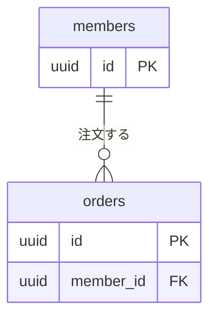

# ER図

（テーブルどうしの関係を示す図であることを 1〜2 文で記述）

作成日：{{YYYY-MM-DD}}
版：v0.1

---

**書き方のルール**

- 基本設計で作り、テーブル、主キー、外部キー、関係の多重度を決める。そのほかのカラムは、詳細設計で `05_DB設計/テーブル定義.md` に書き、この図には書かない
- テーブルは [[05_DB設計/テーブル一覧]] と同じものだけを書く
- 詳細設計でテーブルや外部キーを足すときは、この図にも足し、版を上げる
- 決まっていないことは【未決定】と、何が決まっていないかを書き、未決定事項一覧（`98_レビュー記録/基本設計/未決定事項一覧.md`）に行を足す

## ER図

## 関係の説明

| 関係 | 多重度 | 説明 | 根拠の要件 |
|---|---|---|---|
| （例: `members` と `orders`） | （例: 1 対 0 以上） | （例: 会員は注文を持たないこともある） | （例: FR-XXX-01） |

---

## 変更履歴

| 日付 | 変更者 | 変更内容 |
|---|---|---|
| {{YYYY-MM-DD}} | — | 初版 |
