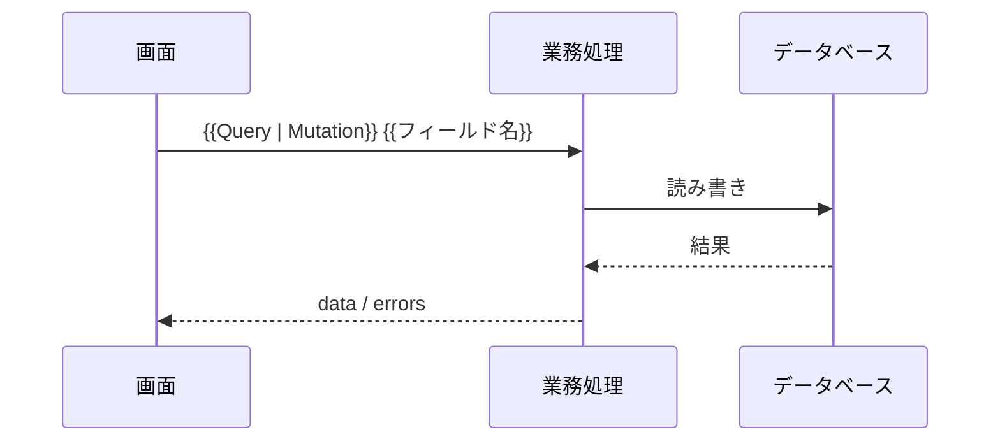

# {{API の名前}}

（この操作の群の概要を記述。方式設計で決めた API の方式が GraphQL のときに、`04_API仕様/API設計書.md` に節を追加する雛形として使う）

**書き方のルール**

- 型、フィールド、引数、戻り値、null を許すかは、`04_API仕様/schema.graphql` を正とし、ここには書き写さない。ここには、スキーマでは表せない振る舞い（エラー、利用者の確認と操作の制限、副作用、やり直したときの扱い、件数の上限）を書く
- `schema.graphql` の操作と、この文書の節と、`API一覧.md` の行は 1 対 1 にする。API ID と操作のフィールド名をそろえる
- 決まっていないことは【未決定】と、何が決まっていないかを書く

## `{{Query | Mutation | Subscription}} {{フィールド名}}`（{{API ID}}）

### 概要

（この操作で何ができるか）

- **種類**: Query / Mutation / Subscription
- **スキーマ**: `04_API仕様/schema.graphql` の `{{型名}}.{{フィールド名}}`
- **利用者の確認**: 要 / 不要
- **操作の制限**: （呼び出せる利用者）
- **対応する要件**: {{FR-XXX-01}}

### 引数の制約

型と null を許すかは `schema.graphql` に書く。ここには、型では表せない制約だけを書く。

| 引数 | 制約（桁数、範囲、形式、相関） | 制約に合わないときのエラー |
|---|---|---|
| （例: `input.name`） | （例: 1〜50 文字） | （例: `VALIDATION_ERROR`） |

### 戻り値の扱い

| 項目 | 内容 |
|---|---|
| 件数の上限と、続きの取り方 | （例: 1 回に 100 件まで。続きは `after` で取る。該当しなければ「該当なし」） |
| 該当するデータがないとき | （例: `null` を返す / 空のリストを返す / エラーにする） |

### エラー

GraphQL の応答の `errors[].extensions.code` に入れるエラーコードを書く。

| エラーコード | 発生する条件 | 部分的な結果を返すか |
|---|---|---|
| `UNAUTHENTICATED` | 利用者を確かめられない | 返さない |
| `VALIDATION_ERROR` | 引数の制約に合わない | 返さない |
| `NOT_FOUND` | 対象のデータがない | （例: 返さない） |

### 副作用とやり直し（Mutation のとき）

| 項目 | 内容 |
|---|---|
| 変えるデータ | （例: `plants` に 1 行を足す） |
| 同じ要求を 2 回受けたときの扱い | （例: 2 件目は作らず、1 件目を返す） |
| 途中で失敗したときの扱い | （例: どのデータも変えない） |

### 処理の流れ

