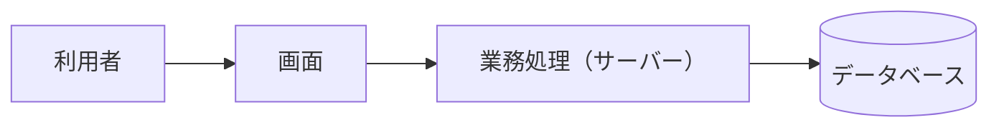

# 方式設計

（システムをどのような構成と方式で実現するかを 1〜2 文で記述）

作成日：{{YYYY-MM-DD}}
版：v0.1

---

この文書は、顧客にも説明する方式設計である。開発チームの内部のルール（層ごとの細かな決まり、テストの書き方、開発の進め方）は、社内向けの `09_開発標準/開発標準.md` に書き、この文書には書かない。

**書き方のルール**

- 開発手法やアーキテクチャの方式の名前（「クリーンアーキテクチャ」「DDD」「TDD」など）を並べるのではなく、その方式で**何が良くなるか**（保守性、品質、性能など）を、顧客に伝わる言葉で書く
- 決まっていないことは【要確認】と書く

## システム構成

| 構成要素 | 役割 | 主な技術 | 稼働する場所 |
|---|---|---|---|
| （例: 画面） | （役割） | （例: React） | （例: 利用者のブラウザ） |
| （例: 業務処理） | （役割） | （例: Python） | （例: AWS） |

## 技術の選定

| 分類 | 採用するもの | 選んだ理由 |
|---|---|---|
| （例: データベース） | （例: PostgreSQL） | （例: 実績が多く、運用の知見が社内にあるため） |

## アプリケーションの構成

アプリケーションの内部を、どのような単位に分けて作るか。顧客にとっての利点とあわせて書く。

| 部分 | 役割 |
|---|---|
| （例: 画面の処理） | （例: 入力の受け付けと結果の表示） |
| （例: 業務ルール） | （例: 業務の判断。画面やデータベースから独立させる） |
| （例: データの保存） | （例: データベースへの読み書き） |

**この構成による利点**：（例: 業務ルールを画面やデータベースから分けることで、仕様を変えるときの影響範囲が小さくなり、保守しやすくなる）

## 非機能要件への対応方針

| 項目 | 方針 |
|---|---|
| 性能 | （例: 主要な画面を 1 秒以内に表示する。そのための方式） |
| 可用性 | （例: 稼働時間の目標と、障害時の復旧方法） |
| セキュリティ | （例: 認証の方式、通信の暗号化、個人情報の扱い） |
| 運用・監視 | （例: ログの保存期間、監視する項目と通知先） |
| バックアップ | （例: 取得の頻度、保存期間、復元の手順） |

## 外部との連携

| 連携先 | 方式 | 頻度 | 障害時の扱い |
|---|---|---|---|
| （例: 決済サービス） | （例: API） | （例: 都度） | （例: 再試行と、失敗時の通知） |

該当しない場合は「該当なし」と書く。

## 品質の確保の方針

顧客に約束する品質の確保の方法を書く。開発チームの内部の進め方（テストの書き方など）は、開発標準に書く。

| 項目 | 方針 |
|---|---|
| テスト | （例: 業務ルールは自動テストで確認し、変更のたびに実行する） |
| レビュー | （例: 設計書とプログラムは、作成者以外が確認する） |

---

## 変更履歴

| 日付 | 変更者 | 変更内容 |
|---|---|---|
| {{YYYY-MM-DD}} | — | 初版 |
