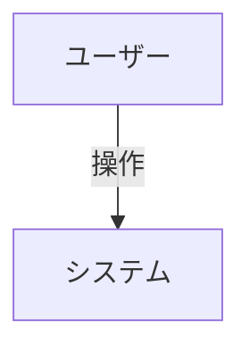

# {{機能名}} 要件定義書

（この機能の目的を 1〜2 文で記述）

作成日：{{YYYY-MM-DD}}
版：v0.1

---

## 用語

| 用語 | 意味 |
|---|---|
| （用語） | （意味。用語集にあるものは書かない） |

## スコープ

### 含めるもの

- （この要件定義書で扱う範囲）

### 対象外

- （扱わないもの。後のフェーズで扱うものは、その旨も書く）

## 機能要件

ID は `FR-<機能の略号>-<2 桁の連番>` で付ける（例: `FR-FAV-01`）。

### FR-XXX-01: {{要件名}}

- **優先度**: 高 / 中 / 低
- **概要**: （要件の概要）
- **詳細**: （要件の詳細）
- **受入条件**:
  - [ ] （条件 1）
  - [ ] （条件 2）

## 非機能要件

ID は `NFR-<機能の略号>-<2 桁の連番>` で付ける。

### NFR-XXX-01: {{要件名}}

- **カテゴリ**: 性能 / セキュリティ / 可用性 / 運用 / その他
- **概要**: （要件の概要）
- **基準**: （定量的な基準値。決まっていなければ【要確認】と書く）

## ユースケース

ID は `UC-<機能の略号>-<2 桁の連番>` で付ける。

### UC-XXX-01: {{ユースケース名}}

- **アクター**: （主なアクター）
- **事前条件**: （事前に満たすべき条件）
- **基本フロー**:
  1. （手順 1）
  2. （手順 2）
- **代替フロー**: （例外的な流れ）
- **事後条件**: （完了後の状態）

## 未決事項

| No | 内容 | 確認先 | 期限 |
|---|---|---|---|
| 1 | （【要確認】の内容） | （確認する相手） | （YYYY-MM-DD） |

---

## 変更履歴

| 日付 | 変更者 | 変更内容 |
|---|---|---|
| {{YYYY-MM-DD}} | — | 初版 |
